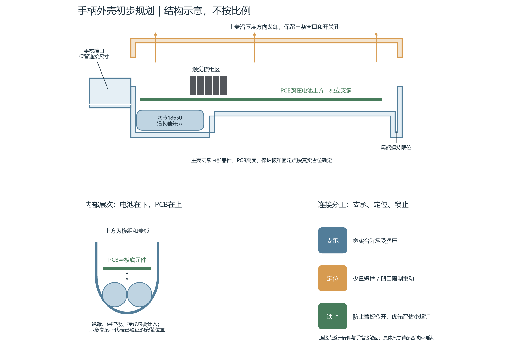

# Handle enclosure: preliminary plan

> **2026-10-11 update:** later checks against the PCB1_5 drill holes show the board must be centred laterally; the Codex Redesign/Concepts/GripStudy models place it 2.75 mm toward −Z. Verified facts and their re-check script: [VERIFIED_FACTS.md](VERIFIED_FACTS.md). Current coaxial design: [Coaxial_v1/](Coaxial_v1/README.md).

Updated 2026-10-10. Hsinlung requested a simple initial plan after the functional review. This is a proposal for discussion; no source geometry has been changed.

## Proposed direction

1. **Retain the two-piece enclosure and existing functional regions.** The main housing contains the cane interface, battery cavity, PCB supports and tail grip stop. The cover carries the three tactile openings and unused switch opening. Preserve the cane connection radius and right-thumb access.
2. **Prefer cover installation/removal along the thickness direction.** Removing the long sliding joint avoids dragging the cover past protruding tactile modules and the switch. Exact removal clearance will be checked with the complete assembly.
3. **Use a substantial seating rim, a few short rigid locating keys/recesses, and separate retention.** The rim supports hand pressure; short keys prevent lateral movement. Ordinary keys alone do not prevent the cover lifting off. Initially investigate small removable screws for retention. Their bosses, screw tips and tool access must fit the actual component space before choosing count, size or location. A flexible snap is not assumed to be the same as a rigid tenon.
4. **Support the PCB independently from the cover and cells.** Place supports at existing mounting holes or clear board-edge regions after checking the underside parts. Cover removal should leave the PCB in place. The cover openings should not squeeze the tactile modules to retain the board.
5. **Keep the cells below the PCB, without a battery holder.** Provide restrained, insulated cell support and space for the existing protection board, terminals and wire bends. Preserve the tail's grip-stop function; smooth its contact edges without removing the stop.

Joint roots and surrounding walls need sufficient material rather than replacing the old groove with equally thin local features. Locate the joint features away from the battery, PCB, module bodies and hand-contact areas. Check a small joint sample before transferring final clearances to the full enclosure; there is no universal printed-fit allowance ([Prusa guidance](https://help.prusa3d.com/article/modeling-with-3d-printing-in-mind_164135)). Flexible snap geometry also depends on material and required deflection ([Formlabs guidance](https://formlabs.com/blog/designing-3d-printed-snap-fit-enclosures/)).

## Confirmed functions and constraints

| Region / feature | Confirmed purpose |
|---|---|
| Front cylindrical socket | Connects to the cane; connection radius is fixed. |
| Deep front cavity | Two 18650 cells, with a separate protection board and no battery holder. |
| PCB space / raised rear floor | Accommodates the board thickness. PCB spans above the battery cavity. Hsinlung: “后面的底面是板的厚度”. |
| Tail region | Helps retain the grip (Hsinlung: “方便握持（类似卡住）”). |
| Three cover openings | Expose 15 real tactile modules, U31–U45, for the right thumb. |
| Round cover opening | Retains the presently unused tactile switch; user-confirmed total height is 20 mm. |
| Original long tongue / groove | Sliding closure; user reports misalignment and fragile groove edges. |

## Measurements from the retained files

The source is `inputs/Handle_Original.3mf`; `Handle_Print.3mf` is byte-identical. SHA256: `25cd55ec492a72cccf81dd1d16a50490106574b93a2b63005601ec6ab786d6c6`. Use the original `source_offset_*` assembly metadata, not the print-bed transforms. CAD X is length, Y thickness, Z width; the cane is at negative X.

| Feature | Measured dimensions / consequence |
|---|---|
| Cane tube | Bore 25 mm, outside 28 mm, wall 1.5 mm. |
| Cover | Roof 2 mm; three apertures 32 mm long and 10 / 9 / 10 mm wide; round hole 5 mm. |
| Deep battery region | Approximately X = 0–67 mm; rail spacing 42 mm; curved inner floor radius approximately 28 mm; maximum centre depth to cover interior 49.5 mm. It is not a rectangular cavity. |
| Original joint | Tongue thickness/projection 1 / 2 mm; groove width/depth 1 / 2 mm. Both nominal clearances are zero. A centred groove in the 2 mm wall leaves two 0.5 mm cheeks. |
| Retained bare PCB STEP | 191.681 × 35.725 × 1.538 mm. |
| Retained PCB with its modelled components | 195.431 × 35.725 × 18.788 mm. Largest underside reach is 7.75 mm below the PCB; the actual cells, protection board, tactile modules and ESP development-board body are absent. These components must not be inferred from this bounding box. |

The zero-clearance joint and 0.5 mm groove cheeks support the reported tight mating and fragile edge problems. They do not identify a unique fracture mechanism. Saved settings specify PLA, 0.4 mm nozzle and 0.2 mm layers; actual failed-part material and orientation are not established by those settings.

## Battery fit: what was actually checked

The accepted baseline is two Molicel P28A cells in a 2S pack, using the existing protection board; cell model may change. The [official P28A datasheet](https://www.molicel.com/wp-content/uploads/INR18650P28A_1.3_Product-Data-Sheet-of-INR-18650-P28A-80093.pdf) gives a maximum bare-cell diameter of 18.6 mm and length of 65.2 mm.

Two 1024-sided cylindrical envelopes at X = 0.9–66.1 mm, centre Y = −15 mm and centres Z = ±9.5 mm have zero intersection volume with the complete original housing and assembled cover. This diagnostic placement leaves 1.8 mm total axial room, 0.4 mm between cells, nominal 2.2 mm rail clearance per side, and approximately 0.94 mm minimum curved-floor clearance.

Thus two bare cells can fit the original shell. This test excludes PCB parts above them, protection board, insulation, wrapping, contacts, wiring and fixing materials. It is not a released mounting position or proof of full-pack fit.

## Assembly checks before setting final dimensions

- The real module drawing dimensions the body as 8.2 × 6 mm and 20 mm high, excluding 3.8 mm terminals; maximum base width including its tab is 10.82 mm. Raised points extend 0.4–0.5 mm above the face. Socket height and pin insertion depth still determine the actual PCB-to-touch-face distance.
- Original PCB module socket models are borrowed 15.65 × 2.1 mm placeholders, with overlapping outlines at the actual 6.5 mm column pitch. They do not represent tactile-body envelopes. The reliable placement grid has three rows and five columns, with approximately 11 mm row pitch matching the cover openings.
- Align the real module active faces and pin/footprint origins before fixing the PCB pose or supports. Aligning only borrowed socket centres does not establish a valid board/cover pose. The existing visual array is not proof of this physical alignment.
- Check local underside parts over the battery region, not the global deepest PCB component placed everywhere. Check the real ESP body, the user-confirmed 20 mm switch and the protection-board envelope as well.
- Choose retention positions only after checking complete boss, fastener and access envelopes. Confirm usable cell clearance after wiring and insulation, then joint allowance with the actual printing process.

## References

- `source.py`: original shell reader and archive transforms.
- `../PCB/3D_PCB1_5_2026-09-15_no_U31-U45_U48_headers.step`: retained PCB geometry with borrowed module sockets removed; September 15 geometry reference, not a complete assembly or proof of a later board revision.
- `../../BrailleModule/inputs/Braille_Module_Reference.pdf`: supplied dimensioned module reference, visually checked on pages 2–5.
- `../../BrailleModule/parameters.json`: distinguishes dimensioned source values from reconstructed visual details.
- `../../BrailleModule_Video/ArrayPreview/EnclosureVerification.json`: shell offsets and aperture coordinates; visual checks do not prove physical PCB fit.
